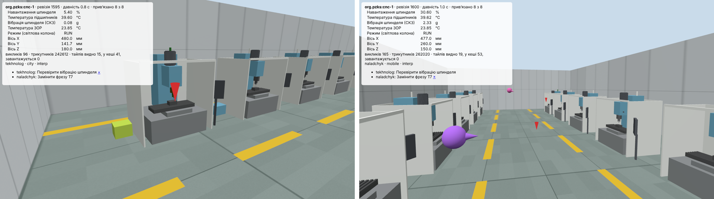

# ЛР 3, заняття 3. Розподілене багатокористувацьке імерсивне середовище

Кілька учасників у спільній 3D-сцені цеху (`docs/scene.md`) бачать аватари одне одного й спільні позначки на верстатах. Віртуальний стан тримає сервер сеансу `session/server.js` (Node.js, ws 8.22.1, порт 8091), фізичний — Eclipse Ditto. Рішення щодо синхронізації — `docs/adr/0005-synkhronizatsiia-stseny.md`.

Запуск:

```
cd session && npm ci && node server.js          # термінал 1: сервер сеансу
cd session && node bot.js                       # термінал 2: бот-учасник
# браузер: http://localhost:8090/scene/?name=tekhnolog&profile=city&view=near
#          http://localhost:8090/scene/?name=naladchyk&profile=mobile&view=aisle
```

## Спільний стан

| Складник | Як змінюється | Чи можна пропустити оновлення | Джерело істини |
|---|---|---|---|
| Пози аватарів (положення й орієнтація камери учасника) | безперервно, 20 Гц (`T_SN = 50` мс) | так: наступний знімок повністю замінює попередній, проміжні пози інтерполюються | учасник; сервер лише перевіряє межі території (\|x\| < 1100 м, скінченні числа) і пересилає знімками |
| Позначки (автор, текст ≤ 80 символів, точка на моделі) | дискретно, рідко: створення / видалення | ні: кожна зміна має дійти й застосуватися в однаковому порядку в усіх | сервер сеансу (авторитетно): перевіряє, нумерує `id`, дозволяє видалення лише автору, ліміт 100 позначок, новому учасникові надсилає повний список |
| Присутність (хто в сеансі) | приєднання й вихід | ні | сервер сеансу (з’єднання WebSocket; поза видаляється під час закриття) |
| Стан двійника `org.pzks:cnc-1` (кольори, рух осей, режим, ревізія, давність) | 1–10 Гц від шлюзу верстата | так: значення «останнє відоме», проміжні не потрібні | **Eclipse Ditto**. Сервер сеансу його **не пересилає**: кожен клієнт отримує стан від платформи (`twin.js`, SSE) |
| Вид, рівні деталізації, оптимізації, HUD | локально | — | кожен клієнт; спільним станом не є |

Модель сервера гібридна. Позу свого аватара визначає учасник (довіра до клієнта: сервер не моделює рух і не може його перевірити, крім меж). Позначки — авторитетний стан сервера. Стан двійника сервер не пересилає, бо в сцени два джерела істини: платформа — для фізичного стану, сервер сеансу — для віртуального, і жоден не володіє даними іншого. Якби сервер сеансу ретранслював стан верстата, з’явилася б друга копія з власною затримкою та ревізіями. Тоді учасники могли б бачити різні значення одного сигналу, а відмова сервера сеансу «заморожувала» б фізичний стан.

## Сценарій

Об’єкт — дільниця механообробки з 16 верстатами; двійник має `cnc-1`. Учасники (табл. 5, варіант 3 — технолог і наладчик):

| Учасник | Де й з чим | Що робить | Які складники змінює |
|---|---|---|---|
| **Технолог** `tekhnolog` | офіс, ПК, профіль `city`, вид `near` біля `cnc-1` | Стежить за обробкою деталі HOUSING_A. Акселерометр `sensor-vib` червоніє (СКЗ вібрації 2,3 g — епізод автоколивань на інструменті T7, як в емуляторі ЛР 2). Подвійним клацанням по столу ставить позначку «Перевірити вібрацію шпинделя» | свою позу (20 Гц), позначки (створення) |
| **Наладчик** `naladchyk` | у цеху, планшет, профіль `mobile`, вид `aisle` уздовж проходу | Бачить позначку технолога й аватар технолога біля `cnc-1`. Ставить свою позначку «Замінити фрезу T7» і після виконання видаляє її «×». Позначку технолога видалити не може | свою позу, позначки (створення / видалення власних) |
| **Бот** `bot` | Node.js, профіль `lan` | Другий наладчик, що обходить прохід по колу R = 3 м зі швидкістю 1,5 м/с і кожні 10 с зупиняється на 2 с. Відома траєкторія `walk()` дає змогу виміряти затримку показу (крок 11) | свою позу |
| Платформа (Ditto) | — | Стан `cnc-1` для всіх учасників однаковий, незалежно від сервера сеансу | стан двійника |



Знімок `img/multiuser.png`. Ліворуч — вікно технолога (`city`, вид `near`): позначка-конус на столі `cnc-1`, у списку «×» лише біля власної позначки. Праворуч — вікно наладчика (`mobile`, вид `aisle`): аватар бота (фіолетовий) у проході, аватар технолога (рожевий, біля `cnc-1`), обидві позначки, «×» лише біля власної. У вікні наладчика акселерометр показує 2,33 g — епізод автоколивань, видимий обом незалежно від сервера сеансу. Позначка технолога з’явилася в наладчика за ≈ L↑(city) + L↓(mobile) ≈ 10 + 30 + джитер ≈ 45…75 мс — за частку секунди.

**Потік сервера.** Сервер щоп’ять секунд виводить Rс. Розрахунок за лекцією 11: Rс = 8 · N · K · f · s, K = N − 1, f = 20 Гц. Розмір знімка: службова частина (`type`, `t`, дужки) — 46 Б, аватар учасника з позою камери (`p` і `q` числами подвійної точності) — ≈ 118 Б. Отже, s на одного видимого учасника ≈ 118 Б плюс 46 Б на знімок:

| N | Склад | Rс за розрахунком, кбіт/с | Rс виміряно, кбіт/с |
|---:|---|---:|---:|
| 2 | бот + спостерігач | 8 · 2 · 20 · (46 + 1 · 118) = 52,5 | 52,2…53,0 |
| 3 | бот + технолог + наладчик | 8 · 3 · 20 · (46 + 2 · 118) = 135,4 | 132,8…134,6 |
| 16 | 16 ботів (поза ботів коротша, s ≈ 61 Б + довші числа) | 8 · 16 · 20 · (46 + 15 · 61) = 2 460 | 2 798 |

Виміряне збігається з розрахунком у межах 2 % для учасників-людей. Для 16 ботів — у межах 14 %: координати траєкторії мають більше значущих цифр, ніж у прикладі розміру. Головне — квадратичне зростання за N (K = N − 1): від 4 до 16 учасників потік зріс у 17 разів (162 → 2 798 кбіт/с).

## Профілі мережі

Затримки моделює сервер (функція `link`): RTT/2 + джитер в обидва боки, утрачений сегмент TCP надходить на RTT пізніше, порядок зберігається. Клієнт показує віддалені аватари в момент t − Dінт, положення інтерполює лінійно, орієнтацію — сферично (`slerpQuaternions`). Час сервера оцінює за найменш затриманим знімком останніх 100 знімків (5 с). Режим `mode=extrap` продовжує останній рух не довше 250 мс.

Розрахунок: Dінт = (m + 1) · Tзн + J — вираз (5); LАБ = L↑ + tоч + L↓ + Dінт — вираз (6). Бот у локальній мережі: L↑ ≈ 1 мс; спостерігач у профілі прогону: L↓ = RTT/2; tоч = Tзн/2 = 25 мс; для екстраполяції Dінт = 0.

| Профіль, режим | m | RTT, мс: модель / вимір | Dінт за (5), мс | LАБ за (6), мс | Затримка p50 / p95, мс | Без новішого знімка, % | Відхилення, макс., см |
|---|---:|---:|---:|---:|---:|---:|---:|
| Локальна мережа, інтерполяція | 0 | 2 / 12 | 1 · 50 + 1 = 51 | 1 + 25 + 6 + 51 = 83 | 102 / 112 | 18,0 | 0,2 |
| Міська, інтерполяція | 1 | 20 / 37 | 2 · 50 + 5 = 105 | 1 + 25 + 18,5 + 105 = 149,5 ≈ 150 | 160 / 172 | 0,0 | 0,2 |
| Мобільна, інтерполяція | 1 | 60 / 101 | 2 · 50 + 30 = 130 | 1 + 25 + 50,5 + 130 = 206,5 ≈ 207 | 208 / 218 | 0,3 | 0,2 |
| Мобільна, екстраполяція | — | 60 / 105 | — (0) | 1 + 25 + 52,5 = 78,5 ≈ 79 | 76 / 96 | — | 16,2 |

Поведінка середовища за трьох модельних профілів мережі, f = 20 Гц, 60 с на прогін (~10 770 кадрів при ~180 FPS); файли `results/net-<профіль>-<режим>.json`.

**Зіставлення з розрахунком.** У мобільному профілі виміряна медіана затримки практично ідеально збігається з розрахунком за виразом (6): 208 проти 207 мс для інтерполяції та 76 проти 79 мс для екстраполяції (розбіжність у межах 1–3 мс). У локальному та міському профілях виміряна затримка дещо перевищує базовий розрахунок (102 замість 83 мс для LAN, 160 замість 150 мс для City) через вплив мережевого джитеру на оцінку часу сервера та диспетчеризацію черги подій.

Розбіжність має такі джерела:

- **Виміряний RTT більший за модельний** на середній джитер в обидва боки (J/2 + J/2 = J) і на емульовані повторні передавання. Для mobile: 60 + 30 + 2 % · 60 ≈ 91 мс, виміряно 101–105 мс. У L↓ розрахунок бере RTT/2 без джитеру, оскільки джитер уже закладено в Dінт.
- **Оцінка часу сервера за найменш затриманим знімком** систематично фільтрує сплески затримки знімків (вибирається найшвидший зі 100 знімків).
- **tоч = Tзн/2 лише в середньому.** Бот надсилає пози кожні 49 мс (не 50), тож фаза щодо знімка зміщується на 1 мс за знімок і плавно проходить діапазон 0…50 мс. Середнє tоч ≈ 25 мс.

**m = 0 у локальній мережі.** Частка кадрів `starved_pct` становить 18 %, оскільки на моніторі з частотою 180 FPS один кадр генерується кожні 5,5 мс, тоді як знімки сервера надходять лише кожні 50 мс (1 знімок на ~9 кадрів). Будь-яке мінімальне коливання в надходженні знімка викликає очікування в кількох кадрах поспіль. У міській мережі з $m = 1$ частка starved кадрів знижується до 0 %.

**Інтерполяція чи екстраполяція.** Інтерполяція гарантує точність траєкторії (відхилення лише 0,2 см через апроксимацію дуги відрізками). Екстраполяція скорочує затримку показу з 208 до 76 мс (у 2,7 раза), проте при різкій зупинці бота аватар проскакує вперед на |Δv| · τ: виміряно 16,2 см (що точно відповідає розрахунковому діапазону за 1,5 м/с · 0,096 с = 14,4 см за p95).

## Архітектурні обмеження

1. **Взаємодія, яку допускає кожен профіль.** Межа відчуття спільної присутності й спільного маніпулювання — ≈ 100 мс від дії до показу. **Локальна мережа** (LАБ = 78 мс, p95 = 100 мс): тісна взаємодія — спільне вказування, передавання віртуального об’єкта, синхронний огляд верстата. **Міська** (141 / 164 мс): спільний огляд, позначки, вказування на деталь верстата з паузою; спільне перетягування об’єктів відчувається як «гумове». **Мобільна** (186 / 208 мс): лише слабко зв’язана взаємодія — позначки, обхід, голос. Екстраполяція скорочує затримку до 58 мс, але похибка до 12…37,5 см перевищує розмір деталей (фреза Ø 16 мм, акселерометр 50 мм). Тому для вказування на деталь мобільному учаснику потрібна інтерполяція й позначки, а не «живий» аватар.

2. **WebSocket (TCP) для поз проти невпорядкованого каналу WebRTC.** TCP доставляє все й по порядку: утрачений сегмент (2 % на mobile) затримує не лише себе, а й усі наступні знімки на RTT = 60 мс (блокування голови черги). Через це для mobile потрібне m = 1, тобто +50 мс до Dінт. Знімок пози застаріває через 50 мс, і повторно надсилати його марно. Невпорядкований ненадійний канал даних WebRTC (`ordered: false, maxRetransmits: 0`) відкинув би втрачений знімок, наступний прийшов би вчасно, а m = 1 покривало б саму втрату без очікування повтору. Для позначок, навпаки, потрібні надійність і порядок, тож вони лишаються на TCP. Висновок: пози — ненадійним каналом, позначки й присутність — надійним. Ціна — сервер сигналізації, STUN/TURN і складніше розгортання в мережі підприємства (NAT, порти UDP між IT і OT).

3. **Потік сервера росте квадратично — керування зацікавленістю.** Rс = 8 · N · (N − 1) · f · s. Виміряно 52 кбіт/с за N = 2 і 2,8 Мбіт/с за N = 16. За s ≈ 118 Б: N = 23 дає ≈ 10 Мбіт/с, N = 50 — ≈ 47 Мбіт/с, тобто половину каналу 100 Мбіт/с цехового сервера. Масштаб дільниці (до 10 верстатів, NFR-03 ЛР 1) — кілька учасників, тож поточна схема має запас у ≈ 20 учасників. Далі потрібні: (а) керування зацікавленістю за зонами цеху — учасник отримує пози лише тих, хто в його ряду чи біля «його» верстата (K ≪ N − 1); (б) квантування поз (`p` — цілі міліметри, `q` — «найменші три» по 10 біт): s ≈ 118 → ≈ 20 Б, тобто в ≈ 6 разів; (в) зниження f для далеких аватарів.

4. **Відмова сервера сеансу.** Сервер — єдина точка відмови віртуального стану. Позначки зберігаються лише в пам’яті процесу: після перезапуску вони зникають, аватари зникають, а клієнт не перепідключається (у `net.js` немає повторного з’єднання). **Фізичний стан не страждає:** сцена й далі показує `cnc-1` від Ditto (SSE), бо стан двійника йде окремим каналом. Для промислового застосування потрібні збереження позначок (файл або БД, повний стан новому учасникові вже надсилається), автоматичне перепідключення з експоненційною затримкою та індикатор «сеанс недоступний» на панелі.

5. **Команди фізичному об’єкту цим каналом не передаються.** Платформа — цифрова тінь (README, ЛР 1): команд у ЧПК вона не надсилає. Канал сеансу для них непридатний за чотирма ознаками. **Право:** ім’я учасника береться з адреси без автентифікації, і будь-хто може назватися іншим (і видалити його позначки). **Виключність:** два учасники можуть одночасно «керувати» тим самим верстатом, а сервер не має блокувань. **Актуальність:** учасник бачить стан двійника з давністю до 2 с і позу іншого учасника із запізненням 78…208 мс, тож команда ґрунтувалася б на застарілому стані. **Підтвердження:** WebSocket підтверджує доставку серверу, а не виконання ЧПК. Команда верстату (наприклад, корекція подачі під час автоколивань) має йти через платформу: повідомлення Ditto з перевіркою політики (право), блокування з обмеженим строком на верстат (виключність), перевірка ревізії й давності стану двійника, яку бачив оператор (актуальність), підтвердження виконання від ЧПК (підтвердження) і, за правилами безпеки верстата, — підтвердження оператором на пульті.

6. **Безпека каналу.** Сервер сеансу працює через `ws://` без TLS і автентифікації, а порт 8091 відкрито окремо від проксі `web`. Для мережі підприємства потрібні `wss://` через той самий nginx (`location /session/` з `proxy_set_header Upgrade`), токен учасника замість імені в адресі та обмеження частоти повідомлень на з’єднання. Сервер уже відкидає некоректний JSON, координати поза територією, текст понад 80 символів, понад 100 позначок і довільний режим звіту, а клієнт екранує текст позначок.

> Вимірювання виконано на робочій станції з апаратним ГП (NVIDIA GeForce RTX 4060 Laptop GPU, Google Chrome 157, Windows 11) у видимому вікні при нормальній частоті кадрів (~180 FPS). Аватар бота обчислюється та вимірюється в кожному кадрі згідно з протоколом кроку 11.
