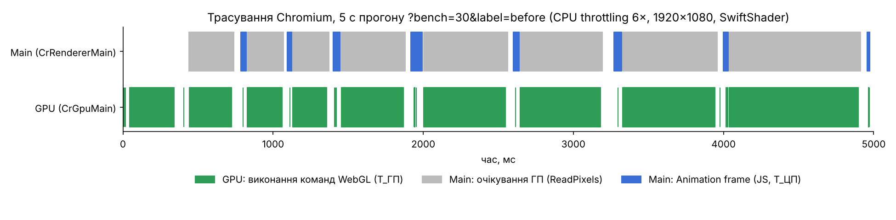

# ЛР 3, заняття 2. Профілювання та оптимізація продуктивності візуалізації

Сцена — цех механообробки з 16 верстатами VMC-850 і рельєф майданчика заводу (`docs/scene.md`). Вимірювання робить модуль `scene/bench.js` (додаток Б інструкції): 3 с прогріву, далі 30 с камера щоразу однаково облітає цех з відстані 8…308 м; роздільна здатність рендерингу — 1920 × 1080. Результати — `results/perf-<позначка>.json`.

## Бюджет

**Найслабший цільовий пристрій.** Подання відкривають технолог і майстер дільниці на офісному ПК або ноутбуці з інтегрованою графікою (Intel UHD / Iris Xe, монітор 60 Гц), а наладчик — на планшеті через цеховий Wi-Fi або LTE. Слабший ЦП моделюємо уповільненням ЦП 6× в інструментах розробника. Слабший ГП не моделюється, тож час ГП вимірюється на машині вимірювань (див. нижче).

| Показник | Ціль | Підстава | Поле результату |
|---|---|---|---|
| Частка кадрів у бюджеті | ≥ 99 % кадрів з max(TЦП, TГП) ≤ 16,7 мс | монітор 60 Гц; вираз (3): Tкадру = 1000/60 = 16,7 мс | `in_budget_pct` (за TЦП і TГП), `in_budget_period_pct` (за фактичним періодом) |
| Виклики рисування за кадр | ≤ 50 | модельне: за (4) (16,7 − 6)/0,2 ≈ 53 при Tлог = 6 мс (оновлення тайлів, SSE, HUD, мережевий модуль) і tвикл = 0,2 мс на слабкому ЦП | `calls_max` |
| Трикутники за кадр | ≤ 300 тис. | модельне: інтегрована графіка, 60 Гц × 300 тис. = 18 млн трикутників/с з запасом на затінення 1920 × 1080 | `triangles_max` |
| Пам’ять текстур | ≤ 16 МБ | модельне: частка пам’яті вкладки браузера на ПК з 8 ГБ, у якого ГП ділить оперативну пам’ять | `textures_mb` |
| Дані до першого кадру | ≤ 1,9 МБ | модельне: 3 с за 5 Мбіт/с (цеховий Wi-Fi або LTE у планшета наладчика): 5 · 3 / 8 = 1,875 МБ | `data_first_frame_mb` |

**Машина вимірювань.** Хмарна віртуальна машина: 2 vCPU, Chromium 153 (headless, Playwright), уповільнення ЦП 6× (`Emulation.setCPUThrottlingRate`), кеш вимкнено (`Network.setCacheDisabled`). Апаратного ГП немає: WebGL2 рендерить SwiftShader — програмний растеризатор на ЦП (`gpu_renderer` у JSON: `ANGLE (Google, Vulkan 1.3.0 (SwiftShader Device (Subzero)))`). Розширення `EXT_disjoint_timer_query_webgl2` SwiftShader не надає, тому `gpu_p50_ms` і `gpu_p99_ms` дорівнюють `null`. Роботу ГП видно лише у фактичному періоді кадру (`frame_p50_ms`) і в трасуванні. Поле `in_budget_period_pct` додано до `bench.js` саме для цього: частка кадрів, фактичний період яких ≤ 1,05 · Tкадру.

> Наслідок для звіту. Показники, що не залежать від ГП (виклики, трикутники, пам’ять текстур, дані до першого кадру, кількість запитів), відтворюються на будь-якій машині й однакові на стенді. Часові показники (TЦП, TГП, частка кадрів у бюджеті) треба перевиміряти на власному комп’ютері з апаратним ГП тими самими шістьма адресами (розділ «До і після»). Модель ГП зазначити в цьому розділі.

## Профілювання

Прогін `?bench=30&label=before` (`results/perf-before.json`):

| Показник | Значення | Бюджет | Стан |
|---|---:|---:|---|
| Кадрів за 30 с / період кадру p50 / p99 | 40 / 783 / 1 367 мс | 16,7 мс | порушено (програмний ГП) |
| TЦП p50 / p99 | 15,0 / 44,1 мс | 16,7 мс | p99 порушено |
| TГП | `null` (немає таймера) | — | див. трасування |
| Частка кадрів у бюджеті за TЦП / за періодом | 60 % / 0 % | ≥ 99 % | порушено |
| Виклики рисування, найбільше | 263 | ≤ 50 | порушено в 5,3 раза |
| Трикутники, найбільше | 305 тис. | ≤ 300 тис. | порушено |
| Пам’ять текстур | 44,7 МБ | ≤ 16 МБ | порушено в 2,8 раза |
| Дані до першого кадру | 6,08 МБ | ≤ 1,9 МБ | порушено в 3,2 раза |

Порушено всі п’ять показників табл. 2.

Трасування 5 с того самого прогону (`browser.startTracing` з категоріями `devtools.timeline`, `gpu` — ті самі події, що в панелі Performance). На доріжці Main завдання кадру анімації (Animation frame) займає ≈ 42 мс на кадр за уповільнення 6×. Решту періоду головний потік чекає на ГП (`GLES2::ReadPixels`, 3,8 с з 5). Доріжка GPU (`CrGpuMain`, `WebGL`) зайнята 4,0 с з 5 — ≈ 500 мс на кадр. **На машині вимірювань сцену обмежує ГП**: tф ≈ TГП ≫ TЦП, вираз (3). На апаратному ГП TГП буде в сотні разів меншим, і вузьким місцем може стати ЦП. Тому виклики рисування оптимізуємо незалежно від цього результату.

Найбільші запити (Network, сортування за розміром; `encodedBodySize`):

| Запит | Передано | Після розпакування | Примітка |
|---|---:|---:|---|
| `models/hall.glb` | 4,04 МБ | 4,04 МБ | дві текстури PNG 2048 × 2048 — 66 % даних до першого кадру |
| `models/cnc-machine.glb` | 1,29 МБ | 1,29 МБ | 39 тис. трикутників, 192 сегменти на коло |
| `three.core.js` + `three.module.js` | 0,51 МБ | 2,13 МБ | gzip з `web.conf` стискає код у 4,2 раза |
| тайли `tiles/site/v1/*/*.glb` | по 0,118 МБ | — | надходять після першого кадру, у міру потреби |

**Вузькі місця:**

| Показник | Причина | Оптимізація, що на нього діє |
|---|---|---|
| Виклики рисування (263) | 16 верстатів × 15 окремих сіток (кожна деталь — вузол з ідентифікатором) + 5 сіток цеху + тайли | інстансування `inst`: одна `InstancedMesh` на деталь для всіх 16 верстатів |
| Трикутники (305 тис.) | детальна модель надлишкова: 192 сегменти на коло й до 24 за висотою; поруч із камерою 3–4 верстати в LOD0 | спрощення `simp` (`gltfpack -si 0.1`, G = 0,2 мм) |
| Пам’ять текстур (44,7 МБ) | дві текстури 2048 × 2048 RGBA з міпмапами: 2 · 2048² · 4 · 4/3 | стиснення текстур `ktx2` (Basis Universal ETC1S → блоковий формат ГП) |
| Дані до першого кадру (6,08 МБ) | `hall.glb` з PNG (4,04 МБ) і детальна модель (1,29 МБ) завантажуються до першого кадру | `ktx2` (зал 4,04 → 0,55 МБ), відкладене завантаження `defer` (детальна модель і тайли — після першого кадру) |
| Час кадру на ГП | програмний растеризатор, 1920 × 1080 з MSAA | на машині вимірювань не усувається; на стенді — менше трикутників (`simp`) і менше пікселів (`setPixelRatio`) |

## Оптимізації

Застосовано всі чотири оптимізації. Кожну вмикає окрема позначка параметра `opt`, тож ефект кожної виміряно окремо. Без `opt` сцена працює так само, як після заняття 1.

1. **Спрощення геометрії (`simp`).** `npx gltfpack -i models/cnc-machine.glb -o models/cnc-machine-s.glb -si 0.1 -kn -ke`: 39 072 → 4 117 трикутників (10,5 %), 1,29 МБ → 85 КБ. Похибка, виміряна `tools/lod-error.mjs`, — G = 0,2 мм. За виразом (2) з ρmax = 1 піксель вона непомітна вже з 0,2 м, тож втрат якості немає: gltfpack прибрав лише зайві сегменти за висотою циліндрів, що лежать в одній площині. *Ціна:* крок підготовки даних; нормалі на гранях циліндрів стають трохи грубішими (у знімках не помітно).
2. **Стиснення текстур (`ktx2`).** `node tools/ktx2.mjs models/hall.glb models/hall-ktx2.glb` — Basis Universal ETC1S з міпмапами, бібліотека ktx2-encoder (WASM). Файл 4,04 МБ → 0,55 МБ. У браузері `KTX2Loader` перекодовує текстуру у блоковий формат, який підтримує ГП. *Ціна:* ETC1S — стиснення з втратами (блоки 4 × 4, помітні на дрібному шумі підлоги впритул); кодування двох текстур триває 14 с; до першого кадру додається декодер Basis (0,27 МБ JS + WASM). SwiftShader не має ETC1/BC1 (4 біти на піксель), тож `KTX2Loader` обрав формат 8 біт на піксель. Через це пам’ять текстур — 11,2 МБ, а не 5,6 МБ, як було б з BC1 на апаратному ГП ПК.
3. **Інстансування (`inst`).** Кожна з 15 деталей усіх 16 верстатів — одна `InstancedMesh`; матриця екземпляра = слот (положення й поворот ряду) · зсув осі ЧПК · матриця деталі. Колір `cnc-1` задає колір його екземпляра (`setColorAt`), а рух осей — його матриця (`setMatrixAt`). Тому прив’язка двійника працює й з інстансуванням. *Ціна:* один об’єкт LOD на всю групу — рівень обирається за відстанню до центру цеху, пороги подвоєно (30/120/500 м). Поблизу цеху всі 16 верстатів переходять на детальну модель одночасно, і трикутників стає більше (781 тис., табл. нижче). Тому інстансування поєднують зі спрощенням. Відсікання за пірамідою тепер працює для всієї групи екземплярів разом.
4. **Відкладене завантаження (`defer`).** До першого кадру верстати показуються спрощеною моделлю LOD1 (46 КБ). Детальна модель завантажується в `afterFirstFrame`, тайли рельєфу — з другого кадру. Кольори й зсуви, накладені двійником до заміни, `station.js` зберігає й застосовує до нових сіток. *Ціна:* перші ≈ 0,5 с поблизу верстата видно спрощену модель; загальний обсяг даних трохи більший (повторний розбір моделей).

Перевірка ідентифікаторів після оптимізацій (`node tools/elements.mjs models/*.glb`): `cnc-machine-s.glb` — 15, `hall-ktx2.glb` — 5. На виді `?view=near&opt=inst,ktx2,simp,defer` колір і рух `cnc-1` змінюються за станом двійника, як і без оптимізацій («прив’язано 8 з 8»), див. `img/scene-optimized.png`: 35 викликів замість 95 на тому самому виді.

## До і після

Прогони `label=simp&opt=simp`, `label=ktx2&opt=ktx2`, `label=inst&opt=inst`, `label=defer&opt=defer` і `label=after&opt=inst,ktx2,simp,defer` виконано з тими самими налаштуваннями, що й `before`.

| Показник | Бюджет | До | simp | ktx2 | inst | defer | Після |
|---|---:|---:|---:|---:|---:|---:|---:|
| Частка кадрів у бюджеті за TЦП, % | ≥ 99 | 60,0 | 66,7 | 71,7 | 71,1 | 71,7 | 76,2 |
| Частка кадрів у бюджеті за періодом, % | ≥ 99 | 0 | 0 | 0 | 0 | 0 | 0 |
| Період кадру: медіана / 99-й процентиль, мс | 16,7 | 783 / 1367 | 783 / 1067 | 700 / 1200 | 833 / 1783 | 700 / 1200 | 783 / 1117 |
| TЦП: медіана / 99-й процентиль, мс | — | 15,0 / 44,1 | 12,6 / 33,0 | 9,7 / 84,7 | 10,3 / 30,4 | 10,5 / 33,3 | 9,7 / 63,2 |
| TГП, мс | — | — | — | — | — | — | — |
| Виклики рисування: медіана / найбільше | ≤ 50 | 41 / **263** | 42 / 263 | 41 / 263 | 29 / **42** | 41 / 264 | 29 / **42** |
| Трикутники, найбільше, тис. | ≤ 300 | **305** | 213 | 321 | **781** | 321 | **222** |
| Пам’ять текстур, МБ | ≤ 16 | **44,7** | 44,7 | **11,2** | 44,7 | 44,7 | **11,2** |
| Дані до першого кадру, МБ | ≤ 1,9 | **6,08** | 4,87 | 2,86 | 6,08 | 4,74 | **1,52** |
| Усього даних за прогін, МБ / запитів | — | 12,3 / 77 | 11,6 / 81 | 9,1 / 79 | 12,3 / 77 | 13,3 / 85 | 7,9 / 79 |

Показники сцени до і після оптимізацій (хмарна ВМ, 2 vCPU, Chromium 153 headless, SwiftShader, уповільнення ЦП 6×, 1920 × 1080). Жирним — показники, на які діє оптимізація.

Як читати таблицю:

- **Виклики рисування.** Лише інстансування зменшує виклики: 263 → 42 (у 6,3 раза). Залишок — 15 інстансованих сіток + 5 сіток цеху + тайли. Медіана 29 відповідає далеким кадрам, де група верстатів у LOD2 або відкинута.
- **Трикутники.** `simp` зменшує найбільше 305 → 213 тис. `inst` без `simp` збільшує до 781 тис.: коли камера ближче за 30 м до центру цеху, усі 16 верстатів одночасно в LOD0 (16 × 39 тис. = 625 тис. + тайли). У поєднанні (`after`) — 16 × 4,1 тис. + тайли = 222 тис. Різниця «до — ktx2/defer» (305 проти 321 тис.) — розкид вибірки: за 1,3–1,5 кадру/с камера в різних прогонах потрапляє в різні точки траєкторії.
- **Пам’ять текстур.** Лише `ktx2`: 44,7 → 11,2 МБ (у 4 рази; на ГП з BC1 було б у 8 разів).
- **Дані до першого кадру.** `ktx2` (−3,49 МБ на залі, +0,27 МБ декодера), `simp` і `defer` (−1,2…1,3 МБ на детальній моделі). Разом 6,08 → 1,52 МБ. Склад після оптимізацій: код бібліотек 0,65 МБ (gzip), `hall-ktx2.glb` 0,55 МБ, декодер Basis 0,27 МБ, `cnc-machine-lod1.glb` 0,05 МБ, власні модулі й `binding.json` 0,01 МБ.
- **TЦП.** Медіана зменшилася 15,0 → 9,7 мс, найбільше через інстансування (менше викликів — менше роботи `WebGLRenderer` на ЦП). 99-й процентиль на 40 кадрах — це другий найгірший кадр, і його розкид визначають сплески (компіляція шейдерів, розбір тайлів), а не оптимізації. Для надійного p99 потрібні сотні кадрів, тобто апаратний ГП.
- **Час до першого кадру** на локальному сервері коливається між прогонами (1,5…2,3 с), тому до таблиці не входить; найменший — у `after` (1 493 мс).

## Висновок

Після оптимізацій виконано **чотири з п’яти** показників бюджету, і саме ті, що не залежать від ГП. Виклики рисування — 42 ≤ 50, трикутники — 222 тис. ≤ 300 тис., пам’ять текстур — 11,2 ≤ 16 МБ, дані до першого кадру — 1,52 ≤ 1,9 МБ. До оптимізацій усі чотири були порушені в 1,02–5,3 раза. Кожна оптимізація подіяла на той показник, на який мала діяти. Єдиний побічний ефект — інстансування без спрощення збільшило трикутники, тому його застосовано лише разом із `simp`.

Частку кадрів у бюджеті на машині вимірювань не досягнуто, і з цим нічого не вдієш: кадр рисує програмний растеризатор (≈ 500 мс на кадр за трасуванням), тому tф ≈ TГП ≫ 16,7 мс за будь-якої сцени. За ЦП (уповільнення 6×) після оптимізацій 76 % кадрів у бюджеті, медіана TЦП — 9,7 мс. Вузьке місце, що лишилося, — **ГП (заповнення пікселів 1920 × 1080 з MSAA)**, а на ЦП — сплески понад 16,7 мс: розбір тайлів у головному потоці та перша компіляція шейдерів. Рішення щодо бюджету кадру потрібно підтвердити прогоном тих самих шести адрес на комп’ютері з апаратним ГП: у прикладі інструкції (Apple M3 Pro) 100 % кадрів були в бюджеті вже до оптимізацій.

Що оптимізувати далі:

1. **gzip для `.glb`.** `web.conf` стискає лише JS/JSON/WASM, а геометрія glTF (`model/gltf-binary`) передається нестиснено. Додавання типу до `gzip_types` або стиснення `gltfpack -cc` (`EXT_meshopt_compression`) зменшить тайли й моделі в 2–4 рази. Це найдешевший виграш для рельєфу: 40 МБ.
2. **Перенести розбір тайлів у Web Worker** і попередньо компілювати шейдери (`renderer.compileAsync`), щоб прибрати сплески TЦП.
3. **Окремий LOD на кожен ряд верстатів** (2 групи по 8 екземплярів замість однієї): поблизу цеху детально рисується лише ближній ряд. Знизить трикутники ще на ≈ 30 % ціною +15 викликів (бюджет дозволяє).
4. **Динамічна роздільна здатність** (`setPixelRatio` за виміряним TГП) для слабкої інтегрованої графіки, де вузьким місцем буде заповнення пікселів.
