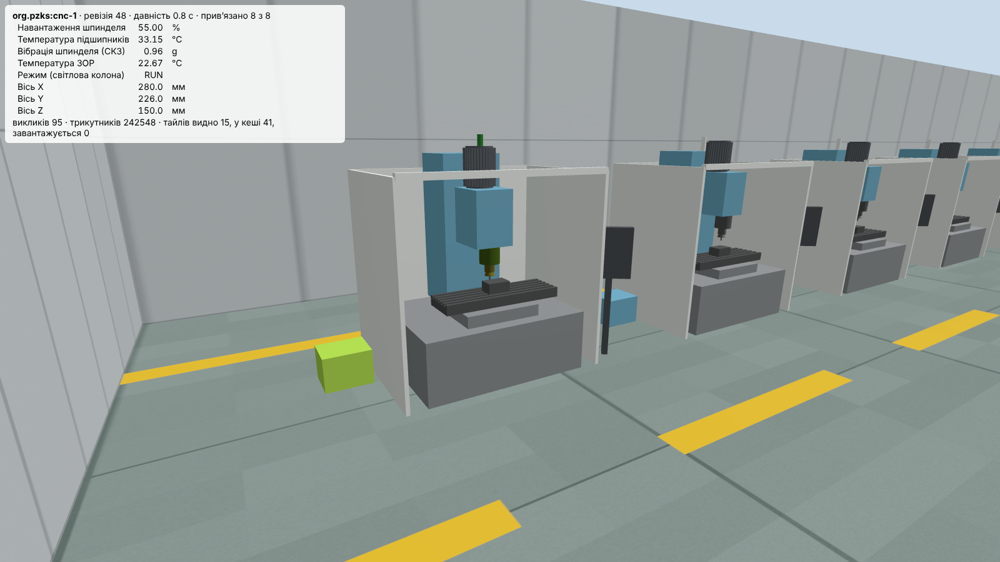

# ЛР 3, заняття 1. 3D-сцена з рівнями деталізації та потоковою геометрією

Об’єкт — той самий, що в ЛР 1–2: 3-осьовий вертикально-фрезерний обробний центр VMC-850 з ЧПК SINUMERIK 828D, двійник `org.pzks:cnc-1` в Eclipse Ditto. Сцена показує цех механообробки з 16 однотипними верстатами (два ряди по 8, крок 4,5 м); стан двійника прив’язано до верстата `cnc-1`, решта — у кольорах моделі (табл. 5 інструкції, варіант 3: «цех із десятків верстатів»). Великий набір даних — рельєф майданчика заводу 2048 × 2048 м у 3D Tiles 1.1.

Запуск (платформа ЛР 2 працює, емулятор — `python emulator/emulator.py --rate 1`):

```
cd scene
npm ci                                   # three@0.187.0, 3d-tiles-renderer@0.5.3, …
node tools/make-model.mjs                # models/cnc-machine.glb, models/hall.glb
npx gltfpack -i models/cnc-machine.glb -o models/cnc-machine-lod1.glb -si 0.03 -kn -ke
node tools/elements.mjs models/*.glb     # ідентифікатори елементів у кожному файлі
node tools/make-tiles.mjs                # tiles/site/v1 — 341 тайл, 40 МБ (не в Git)
cd ../platform && docker compose up -d web
```

Адреси: <http://localhost:8090/scene/?view=near>, `?view=hall`, `?view=far`; `&cull=0` вимикає відсікання за пірамідою видимості, `&error=32` задає `tiles.errorTarget`.



## Модель і ідентифікатори

**Джерело моделі.** Модель складено з примітивів three.js сценарієм `scene/tools/make-model.mjs` (аналог додатка А інструкції, переписаний під верстат). Ліцензія — власна робота автора репозиторію, без обмежень; сторонніх моделей і текстур не використано. Габарити відповідають атрибутам двійника ЛР 2 (`travelX = 762`, `travelY = 406`, `travelZ = 508` мм) і реальному класу VMC-850: станина 2,2 × 1,6 м, висота з колоною сигналізації 3,04 м. Одиниці — метри, вісь Y угору (glTF 2.0). Цех `hall.glb` — підлога 40 × 18 м і стіни 6 м з двома процедурними текстурами PNG 2048 × 2048 (епоксидна підлога з розміткою проходу, сендвіч-панелі), потрібними для оптимізації KTX2 на занятті 2.

Кожна деталь, до якої прив’язано сигнал або рух, — окремий вузол glTF з ім’ям і `extras.element`. Надлишкова деталізація навмисна (192 сегменти на коло, 8–24 сегменти за висотою циліндрів), щоб рівням деталізації було що спрощувати.

| Рівень | Файл | Трикутників | Розмір | Як отримано |
|---|---|---:|---:|---|
| LOD0 — детальна | `models/cnc-machine.glb` | 39 072 | 1,29 МБ | `node tools/make-model.mjs` |
| LOD1 — спрощена | `models/cnc-machine-lod1.glb` | 1 516 | 45,7 КБ | `gltfpack -si 0.03 -kn -ke` |
| LOD2 — паралелепіпед | будується в `station.js` (`boxOf`) | 12 | — | обмежувальний об’єм моделі |
| LOD3 — порожній | `new THREE.Object3D()` | 0 | — | відсікання за відстанню |
| Цех | `models/hall.glb` | 60 | 4,04 МБ | 2 текстури PNG 2048 × 2048 |

Перевірка, що ідентифікатори пережили спрощення (`node tools/elements.mjs models/*.glb`):

```
models/cnc-machine-lod1.glb: 15 — base, saddle, table, workpiece, column, head, motor, bearing, spindle, tool, enclosure, panel, coolant, lamp, sensor-vib
models/cnc-machine.glb: 15 — base, saddle, table, workpiece, column, head, motor, bearing, spindle, tool, enclosure, panel, coolant, lamp, sensor-vib
models/hall.glb: 5 — floor, wall-n, wall-s, wall-w, wall-e
```

**Чому `-si 0.03`, а не `-si 0.1`, як у прикладі.** Похибку спрощення виміряно сценарієм `tools/lod-error.mjs` (двобічна відстань Гаусдорфа за 4 000 точок поверхні в кожному напрямку). За `-si 0.1` (4 117 трикутників) G = 0,2 мм: gltfpack прибрав лише зайві сегменти за висотою циліндрів, які лежать в одній площині, тож такий «LOD1» майже без втрат і перемикатися на нього можна вже з 0,2 м. Такий файл використано як `cnc-machine-s.glb` для оптимізації `simp` (заняття 2). Для LOD1 потрібне відчутне спрощення, тому взято `-si 0.03`: 1 516 трикутників (3,9 %), G = 17,2 мм.

| Ідентифікатор | Деталь | Сигнал двійника `org.pzks:cnc-1` |
|---|---|---|
| `base` | станина (чавун) | — |
| `saddle` | каретка осі Y | рух: `axes.positionY` |
| `table` | стіл з Т-пазами, вісь X | рух: `axes.positionX` + `axes.positionY` |
| `workpiece` | заготовка в лещатах | рух разом зі столом |
| `column` | стійка | — |
| `head` | шпиндельна бабка, вісь Z | рух: `axes.positionZ` |
| `motor` | двигун шпинделя 15 кВт | рух разом з бабкою |
| `bearing` | корпус підшипників шпинделя (Pt100) | колір: `spindle.bearingTemperature`, 25…60 °C |
| `spindle` | шпиндель | колір: `spindle.load`, 0…100 % |
| `tool` | кінцева фреза Ø 16 мм | рух разом з бабкою |
| `enclosure` | захисна кабіна | — |
| `panel` | пульт оператора ЧПК | — |
| `coolant` | бак ЗОР | колір: `status.coolantTemperature`, 18…35 °C |
| `lamp` | світлова колона | колір за переліком: `status.mode` (RUN / IDLE / TOOL_CHANGE / ALARM) |
| `sensor-vib` | акселерометр на шпиндельній бабці (S01) | колір: `vibration.rms`, 0…2,5 g |

## Прив’язка телеметрії

Ланцюжок від моделі до властивості двійника:

```
вузол glTF "spindle"  ──►  extras.element = "spindle"  ──►  three.js: userData.element
   (make-model.mjs)          (зберігають gltfpack -kn -ke)      (GLTFLoader переносить extras)
        │
        ▼
binding.json: { "node": "spindle", "feature": "spindle", "property": "load", "min": 0, "max": 100 }
        │
        ▼
Ditto: thing org.pzks:cnc-1 → features.spindle.properties.load   (mapping.js ЛР 2: поле ld шлюзу)
```

1. **Модель.** `make-model.mjs` дає кожній деталі ім’я вузла й `extras.element`. GLTFLoader переносить `extras` у `object.userData`.
2. **Спрощення.** gltfpack з `-kn -ke` зберігає іменовані вузли й `extras`, але сітку може перенести в неіменований дочірній вузол. Тому `station.js` шукає ідентифікатор у найближчого предка (`elementOf`). Без `-ke` `elements.mjs` показує 0 — ланцюжок рветься на цьому кроці.
3. **Таблиця прив’язки** `scene/binding.json` — дані, а не код. Вона має три види записів: `bindings` — шкала кольору від зеленого (min) до червоного (max), 4 елементи; `states` — колір за значенням-переліком (світлова колона за `status.mode`); `motions` — переміщення вузлів за координатами осей ЧПК (стіл за X, каретка за Y, шпиндельна бабка з двигуном, шпинделем і фрезою — за Z). Разом 8 прив’язок; панель показує «прив’язано 8 з 8».
4. **Стан двійника.** `twin.js` бере початковий стан запитом `GET /api/2/things/org.pzks:cnc-1?fields=features,_revision`, а зміни — потоком SSE `/api/2/things?ids=…` через проксі `web` (лише GET, як у ЛР 2). На панелі видно ревізію, давність (`sync.ts`, червона після 2 с) і значення сигналів.
5. **Фарбування.** `paint` один раз клонує матеріал сітки: GLTFLoader створює один матеріал на всі сітки зі спільним матеріалом glTF (наприклад, `steel` — у столу, шпинделя й підшипників), а `clone()` моделі матеріали не копіює. Без власної копії зміна кольору перефарбувала б усі 16 верстатів. Переміщення (`move`) змінює `position` іменованого вузла відносно запам’ятованого початкового. Обидві функції обходять увесь об’єкт LOD, тож стан видно на кожному рівні деталізації.

Місця, де ланцюжок може розірватися: експорт без `extras` (Blender без Include → Custom Properties); gltfpack без `-ke`; описка в `node` чи `property` у `binding.json` (тоді лічильник «прив’язано» менший за загальну кількість); зміна відображення `mapping.js` без оновлення `binding.json`; недоступний проксі `/api/` (давність стає червоною, колір лишається останнім відомим).

Знімок `img/scene.png`: двигун, шпиндель, підшипники, акселерометр і бак ЗОР `cnc-1` пофарбовано за станом, світлова колона зелена (RUN), стіл зсунуто за X/Y, фреза опущена до заготовки (Z = 150 мм — різання). Сусідні верстати — у кольорах моделі.

> Знімки й вимірювання цього звіту отримано в headless Chromium (рендеринг SwiftShader, 1920 × 1080). Сцену віддавав nginx з `platform/web.conf`, стан — заглушка API Ditto `scene/tools/mock-ditto.mjs`, яка відтворює формат `emulator.py` після `mapping.js`. Кількість викликів, трикутників і тайлів від ГП не залежить. На стенді з Ditto числа ті самі, а знімок перезнімається з реальним станом.

## Рівні деталізації та відсікання

Кожен верстат — `THREE.LOD` з чотирма рівнями: детальна модель ближче за 15 м, спрощена — від 15 м, паралелепіпед — від 60 м, порожній об’єкт — від 250 м (відсікання за відстанню). Гістерезис 10 % (третій параметр `addLevel`): до детальнішого рівня сцена повертається лише ближче за 13,5 м і 54 м, тож на межі рівні не мерехтять. Відсікання за пірамідою видимості three.js виконує сам за обмежувальними сферами; `?cull=0` вимикає його. Відсікання задніх граней задає матеріал glTF (`doubleSided: false`).

**Обґрунтування порогів виразом (2)** (H = 1080 пікс., θ = 60°, d* = G·H / (2·ρmax·tg 30°) = 935·G/ρmax):

| Перехід | G (`tools/lod-error.mjs`, max) | ρmax, пікс. | d* за (2), м | Обраний поріг, м | ρ на порозі, пікс. |
|---|---:|---:|---:|---:|---:|
| LOD0 → LOD1 (спрощена) | 0,0172 м | 1 | 16,1 | **15** | 1,07 |
| LOD1 → LOD2 (паралелепіпед) | 0,934 м | 16 | 54,6 | **60** | 14,6 |
| LOD2 → не рисувати | 4,0 м (найбільший габарит; зникає весь верстат) | 16 | 234 | **250** | 15,0 |

Для LOD1 взято ρmax = 1 піксель: на близьких видах оператор розглядає саме деталі (фреза, лещата), і похибка спрощення не має бути помітною. Для паралелепіпеда й відсікання взято ρmax = 16 пікселів, як `errorTarget` рельєфу: на таких відстанях верстат — елемент загального плану цеху. Пороги округлено до 15/60/250 м так, щоб ρ на порозі не перевищувала ρmax більше ніж на 7 %.

Вимірювання (1920 × 1080, значення з панелі після завантаження тайлів):

| Вид | Відсікання | Викликів | Трикутників | Що видно |
|------|------------|---------:|------------:|------------------------|
| near | так        |       95 |     242 548 | cnc-1 детально, північний ряд, рельєф |
| near | ні         |      260 |     372 532 | те саме |
| hall | так        |      263 |     171 772 | 16 верстатів, спрощено (LOD1), цех, рельєф |
| hall | ні         |      263 |     171 772 | те саме |
| far  | так        |       23 |     147 516 | рельєф і цех, верстати відкинуто за відстанню |
| far  | ні         |       23 |     147 516 | те саме |

Висновки:

- **near.** Відсікання за пірамідою прибирає 165 з 260 викликів (63 %) і 35 % трикутників: південний ряд (8 верстатів × 15 сіток) і частина тайлів позаду камери. Виграш менший, ніж у прикладі (понад 2/3), бо з точки біля cnc-1 видно весь північний ряд — 8 верстатів.
- **hall.** Видно все, тому виграшу немає. Південний ряд закритий південною стіною, але все одно рисується: перекриттям (occlusion culling) three.js не відсікає. 263 виклики = 16 × 15 сіток + 5 сіток цеху + 18 тайлів. Це головне вузьке місце для заняття 2.
- **far.** Верстати далі за 250 м відкинуто за відстанню (LOD3): лишилися 5 сіток цеху й 18 тайлів. Перемикач `cull` тут нічого не змінює, бо все, що лишилося, у піраміді видимості.
- Різниця near/hall у трикутниках показує роботу LOD: у виді near cnc-1…cnc-3 ближче за 15 м від камери й рисуються детально (39 тис. трикутників кожен), у виді hall усі 16 — спрощено (1,5 тис. кожен): 16 × 1 516 + 60 + 18 × 8 192 = 171 772, як і виміряно.

## Потокове завантаження

Великий набір даних — модельний рельєф майданчика заводу 2048 × 2048 м навколо цеху (центральна площадка радіусом 60 м рівна). Формат — 3D Tiles 1.1, явне квадродерево з уточненням `REPLACE`; сценарій — `scene/tools/make-tiles.mjs`. Разом 341 тайл (рівні 0…4), 40,2 МБ, 2,79 млн трикутників. Набір перевищує бюджет клієнта за двома ресурсами: пам’яттю (40,2 МБ > кеш тайлів 32 МіБ = 33,5 МБ) і даними до першого кадру (40,2 МБ ≫ 1,9 МБ з бюджету заняття 2). Тому його не можна завантажити цілком — лише потоково.

Похибка рівня k — крок сітки Gk = 32/2^k м (у листків — 0). Відстані уточнення за виразом (2) для H = 1080 пікс., θ = 60°, ρmax = `errorTarget` = 16:

| k | Тайл, м | Крок сітки, м | Gk, м | d* за (2), м | Тайлів |
|---|---:|---:|---:|---:|---:|
| 0 | 2048 | 32 | 32 | 1871 | 1 |
| 1 | 1024 | 16 | 16 | 935 | 4 |
| 2 | 512 | 8 | 8 | 468 | 16 |
| 3 | 256 | 4 | 4 | 234 | 64 |
| 4 | 128 | 2 | 0 (листок) | — | 256 |

`TilesRenderer` у `main.js` щокадру відкидає тайли поза пірамідою видимості, уточнює ті, де ρ > 16 пікселів, ставить потрібні в чергу запитів і тримає завантажені в LRU-кеші з бюджетом 24…32 МіБ. На вкладці Network з фільтром `tiles` видно, що тайли надходять у міру руху камери; nginx віддає їх із `Cache-Control: public, max-age=31536000, immutable` (нова версія — новий каталог `v2`).

Частка завантажених тайлів (1920 × 1080, `errorTarget = 16`):

| Вид | Видно тайлів | У кеші | Частка від 341 | Завантажено, МБ |
|---|---:|---:|---:|---:|
| near | 15 | 41 | 12,0 % | 4,8 |
| hall | 18 | 53 | 15,5 % | 6,2 |
| far | 18 | 37 | 10,9 % | 4,4 |
| far, `errorTarget = 32` | 9 | 21 | 6,2 % | 2,5 |

За `errorTarget = 32` у виді far видно 9 тайлів замість 18, трикутників — 73 788 замість 147 516, а рельєф помітно грубішає: d* кожного рівня вдвічі менша, тож уточнення починається вдвічі ближче. У виді hall `errorTarget = 32` нічого не змінив (ті самі 53 тайли): камера на висоті 16 м над площадкою, і всі тайли під нею — листки, які далі не уточнюються.

**Якщо потрібні тайли не вміщуються в бюджет кешу.** Кеш вивантажує найдавніше використані тайли, але не ті, що потрібні в поточному кадрі. Якщо видимий набір більший за `maxBytesSize`, кеш тимчасово перевищує бюджет (пам’ять росте) або, за жорсткого ліміту, тайли поперемінно вивантажуються й завантажуються знову (трешинг): трафік і черга запитів ростуть, на екрані лишаються грубіші батьківські тайли або діри, рельєф «мерехтить» рівнями. Протидія: збільшити `errorTarget` (менше тайлів на тій самій відстані), зменшити роздільну здатність, обмежити дальність огляду (`camera.far`, відсікання за відстанню) або зменшити розмір тайла (стиснення геометрії `EXT_meshopt_compression`, квантування). Для нашого набору видимий набір (≤ 53 тайли × 117 КБ ≈ 6,2 МБ) у бюджет 32 МіБ вміщується з великим запасом. Бюджет переповнюється лише тоді, коли весь майданчик потрібен у листках одночасно.
