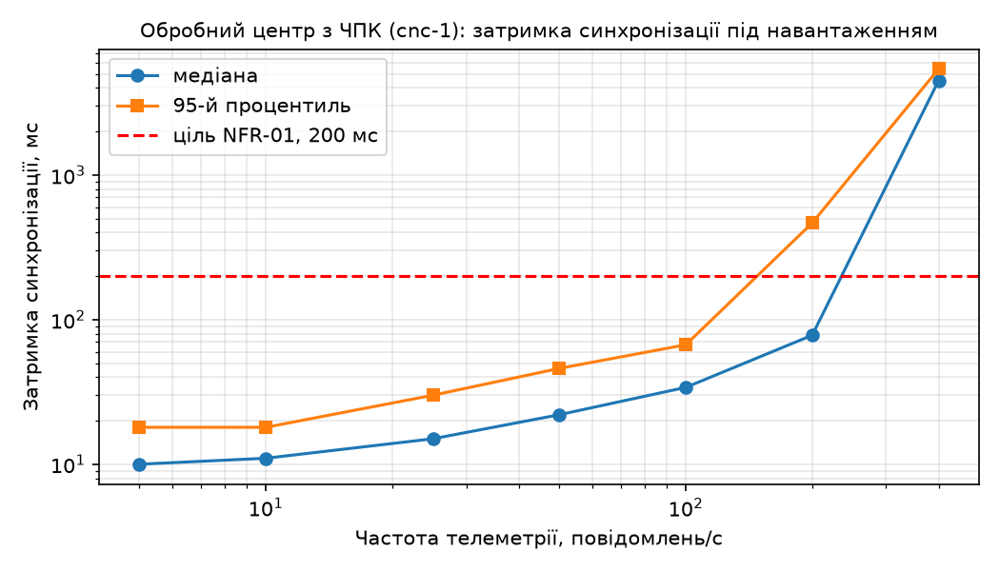

# Синхронізація стану та навантажувальне тестування

ЛР 2, заняття 4. Перевіряються NFR-01 ЛР 1 (затримка синхронізації p95 ≤ 200 мс) і поведінка платформи під зростанням частоти телеметрії одного двійника.

## Історія станів

Історик `sync/historian.py` підписаний на потік змін двійника `org.pzks:cnc-1` (SSE через проксі `web`, лише читання) і записує кожен стан у InfluxDB (вимірювання `twin_state`, кошик `twin`, 7 діб) з **міткою часу джерела** `sync/ts`. Мітка — у наносекундах з номером повідомлення в молодших розрядах: за 10 Гц і вище кілька станів мають однакову мітку в мілісекундах, і без цього InfluxDB перезаписувала б точки, а «втрати» виявилися б артефактом сховища. Режим ЧПК записується рядковим полем, решта — числовими.

Затримка синхронізації за формулою (3): L_с = t_API − t_дж, де t_дж = `sync/ts` (емулятор ставить її за годинником хоста), t_API — момент, коли історик отримав подію SSE (той самий годинник хоста). Обидві мітки — з одного годинника, тому розбіжність годинників контейнерів не впливає; але L_с включає всю ділянку «шлюз → брокер → з’єднання → Ditto → SSE → історик», тобто це затримка, яку бачить споживач API, — затримка, яку бачить споживач API. Це **не вся** затримка NFR-01 ЛР 1: там відлік іде від мітки джерела (OPC UA SourceTimestamp або мітки DAQ), а емулятор ставить `ts` у момент публікації, тобто вже після ділянок L1 «ЧПК/датчик → шлюз» (≈ 40 мс) і L2 «обробка на шлюзі» (≈ 60 мс) з `latency.md`. Тому виміряне значення порівнюємо з ціллю 200 мс, але для повної перевірки NFR-01 на цю ділянку лишається бюджет ≈ 100 мс.

Панель Grafana — `platform/grafana-dashboard.json` (навантаження шпинделя й СКЗ вібрації; максимальна затримка синхронізації з лінією цілі 200 мс; енергія за смугами вібрації). Її можна імпортувати: Dashboards → New → Import → завантажити файл.

<!-- AUTO:grafana -->
<!-- /AUTO:grafana -->

## Перевірка узгодженості

`sync/consistency.py` порівнює `results/source.csv` (що надіслало джерело) з історією станів і поточним станом двійника: повноту, збіг усіх 22 значень (числа з точністю 1e-9, режим — як рядок), порядок застосування за ревізіями, пропущені ревізії, кінцевий стан і затримку p50/p95.

**Штатний прогін** — 300 повідомлень з частотою 10/с (`python emulator/emulator.py --rate 10 --count 300`, потім `python sync/consistency.py`):

<!-- AUTO:consistency -->
<!-- /AUTO:consistency -->

**Прогін з навмисною помилкою.** У `platform/mapping.js` переставлено оберти й навантаження шпинделя (`speed: m.ld, load: m.s`), з’єднання оновлено (`python platform/connection.py`), повторено обидва запуски:

<!-- AUTO:consistency_swap -->
<!-- /AUTO:consistency_swap -->

Пояснення. Під час обробки оберти ≈ 8000 об/хв потрапляють у `spindle/load` з діапазоном 0…150 %, і Ditto відхиляє команду `merge` цілком (`wot:payload.validation.error`) — ці повідомлення зникають з історії: модель двійника спрацювала як перший рубіж перевірки. На відміну від прикладу насосного агрегату, тут відхиляються **не всі** повідомлення: у простої й під час заміни інструмента оберти й навантаження обидва дорівнюють 0, перестановка їх не змінює, і такі стани застосовуються правильно. Тобто перевірка ловить помилку двома способами — як втрати, коли значення виходить за модель, і як «Розбіжність значень», якби переставлені величини мали спільний діапазон. Після перевірки відображення повернуто й `connection.py` виконано знову.

## Навантажувальне тестування

`load/locustfile.py`: кожен користувач Locust — шлюз, що публікує 5 повідомлень/с з QoS 1 у тему `pzks/cnc-1/telemetry`; кількість шлюзів ступенями 1, 2, 5, 10, 20, 40, 80 → частота 5…400 повідомлень/с **в один двійник**, 60 с на ступінь, після пробного прогону по 10 с. Емулятор зупинено, історик працює. `load/analyze.py` зіставляє `results/sent.csv` з історією в InfluxDB.

<!-- AUTO:locust -->
<!-- /AUTO:locust -->

Результати за ступенями (`results/load.csv`):

<!-- AUTO:load_table -->
<!-- /AUTO:load_table -->

Звіт Locust: `results/locust.html`.

## Висновок щодо масштабованості

<!-- AUTO:conclusion -->
<!-- /AUTO:conclusion -->

**Що обмежує пропускну здатність — формула (5).** Оновлення одного двійника Ditto обробляє послідовно (один «прилад» у моделі масового обслуговування): кожна команда `merge` проходить відображення JavaScript, перевірку політики, **валідацію за моделлю WoT** (5 підмоделей, 24 властивості), запис ревізії в журнал подій MongoDB і розсилку події SSE. Поки інтенсивність надходження λ далека від інтенсивності обслуговування μ, час перебування W = 1/(μ − λ) майже сталий і визначається власною тривалістю обробки; коли λ наближається до μ, черга перед двійником росте, і затримка зростає необмежено — це «коліно» графіка. Наш об’єкт навантажує платформу важче за насосний агрегат: 22 властивості замість 5, отже більша вартість валідації й більші події.

**Як масштабувати:**

- **Більше об’єктів (дільниця, тисяча верстатів).** Кожен верстат — окремий двійник; Ditto розподіляє різні двійники між вузлами кластера (шардування), тож сумарна пропускна здатність зростає майже лінійно з кількістю вузлів `things` і `connectivity`. Для 1000 верстатів × 10 Гц = 10 000 оновлень/с потрібні кілька вузлів, кластер MongoDB, розділення тем MQTT між кількома клієнтами з’єднання (`clientCount`) і кластер брокера; для NFR-03 ЛР 1 (10 верстатів, 100 оновлень/с сумарно) достатньо одного вузла, якщо 10 Гц на двійник лежить нижче коліна.
- **Вища частота одного об’єкта.** Горизонтальне масштабування тут не допомагає — двійник обробляється послідовно на одному вузлі. Отже: (1) не підвищувати частоту стану понад потребу — двійник зберігає стан, а не потік; агрегувати на периферії (як 8 ознак вібрації замість 5 кГц, ADR-0003); (2) розділити двійник на кілька — наприклад, окремі двійники для вібрації й для осей, кожен зі своїм потоком; (3) швидкі сигнали (сира вібрація) вести повз двійник одразу в сховище часових рядів, а в двійник писати лише події й агрегати; (4) зменшити вартість однієї команди — пакувати кілька відліків в одне оновлення.
