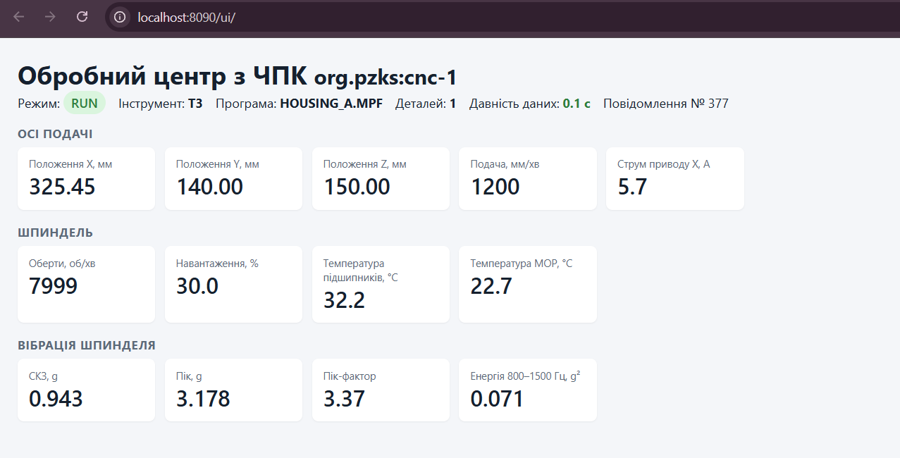

# Канал телеметрії IoT та вебподання

ЛР 2, заняття 3. Маршрут: емулятор граничного шлюзу (`emulator/emulator.py`, OME) → Mosquitto (порт 1883) → з’єднання Ditto `mqtt-telemetry` з відображенням `platform/mapping.js` (DCE) → двійник `org.pzks:cnc-1` (DTE) → SSE через проксі `web` → вебподання `ui/index.html` (UE).

## Перевірка брокера

```
cd platform
docker compose exec -T mosquitto mosquitto_sub -t "pzks/#" -v          # термінал 1
docker compose exec -T mosquitto mosquitto_pub -t pzks/test -m "перевірка"   # термінал 2
```

<!-- AUTO:broker_test -->
<!-- /AUTO:broker_test -->

## Схема повідомлення

**Тема:** `pzks/<ім’я двійника>/telemetry`, для нашого верстата — `pzks/cnc-1/telemetry`. **QoS** 1 (щонайменше один раз; дублікати безпечні, бо `merge` ідемпотентний, а `seq` дозволяє їх виявити). **Формат:** JSON UTF-8, один об’єкт — стан верстата за останні 100 мс; **частота** 10 повідомлень/с (`--rate` емулятора змінює її для дослідів). Розмір ≈ 320 Б (310–330 Б).

Опис полів за структурою специфікації можливостей датчика IEEE 2888.1 (величина, одиниця, тип, діапазон, точність/роздільність, частота):

| Поле | Величина | Одиниця | Тип | Діапазон | Точність (роздільність) | Сигнал ЛР 1 → модель |
|---|---|---|---|---|---|---|
| `seq` | номер повідомлення шлюзу | — | integer | ≥ 1, монотонно зростає | 1 | → `sync/seq` |
| `ts` | час відліку на шлюзі | мс від 1970-01-01 UTC | integer | ≥ 0 | 1 мс (годинник хоста) | → `sync/ts` |
| `x`, `y`, `z` | фактичне положення осей | мм | number | 0…762 / 0…406 / 0…508 | 0,001 мм | S04–S06 → `axes/positionX…Z` |
| `f` | фактична подача | мм/хв | number | 0…25 000 | 0,1 мм/хв | S07 → `axes/feedRate` |
| `ix` | струм приводу X, макс. за 100 мс | А | number | 0…30 | 0,01 А | S08 → `axes/currentX` |
| `s` | оберти шпинделя | об/хв | number | 0…12 000 | 0,1 об/хв | S03 → `spindle/speed` |
| `ld` | навантаження шпинделя, макс. за 100 мс | % | number | 0…150 | 0,1 % | S02 → `spindle/load` |
| `tb` | температура підшипників шпинделя | °C | number | 10…80 | 0,01 °C (похибка Pt100 кл. A ±0,15 °C) | S09 → `spindle/bearingTemperature` |
| `md` | режим ЧПК | — | string (enum) | OFF, IDLE, RUN, FEED_HOLD, TOOL_CHANGE, ALARM, E_STOP | — | S11 → `status/mode` |
| `tl` | номер інструмента | — | integer | 0…24 | 1 | S12 → `status/toolNumber` |
| `al` | код аварії ЧПК | — | integer | 0…65 535 (0 — немає) | 1 | S13 → `status/alarmCode` |
| `pg` | активна NC-програма | — | string | до 64 символів | — | FR-01 → `status/program` |
| `pc` | лічильник оброблених деталей | шт. | integer | 0…999 999 | 1 | FR-01 → `status/partCount` |
| `tc` | температура МОР | °C | number | 10…50 | 0,01 °C | S10 → `status/coolantTemperature` |
| `vr` | СКЗ прискорення | g | number | 0…50 | 0,0001 g (АЦП 16 біт, ±50 g) | S01 → `vibration/rms` |
| `vp` | пікове прискорення | g | number | 0…50 | 0,0001 g | S01 → `vibration/peak` |
| `vc` | пік-фактор | — | number | 1…20 | 0,001 | S01 → `vibration/crestFactor` |
| `vk` | ексцес | — | number | 0…50 | 0,001 | S01 → `vibration/kurtosis` |
| `b1`…`b4` | енергія в смугах 0–200, 200–800, 800–1500, 1500–2000 Гц | g² | number | 0…100 | 0,00001 g² | S01 → `vibration/band1…band4` |

Приклад повідомлення (формат емулятора):

```json
{"seq": 1, "ts": 1793039939478, "x": 279.998, "y": 152.527, "z": 150.0, "f": 1200.0, "ix": 6.25,
 "s": 7996.6, "ld": 35.8, "tb": 31.0, "md": "RUN", "tl": 7, "al": 0, "pg": "HOUSING_A.MPF", "pc": 0, "tc": 22.5,
 "vr": 0.8892, "vp": 2.978, "vc": 3.349, "vk": 3.151, "b1": 0.02, "b2": 0.47439, "b3": 0.06325, "b4": 0.02372}
```

Короткі назви полів — формат пристрою (як у реального шлюзу, економія трафіку). **Перетворення на модель виконує з’єднання Ditto (DCE), а не емулятор:** `mapping.js` бере ім’я двійника з теми й розкладає поля по функціональних блоках командою `merge` на `/features`. Заміна шлюзу чи датчика (інші назви полів, інша частота) змінить лише `mapping.js`; модель типу, двійник, історик і подання лишаються без змін.

Емулятор відтворює цикл обробки деталі тривалістю 120 с: простій → три операції з трьома інструментами (T3, T7, T12), кожна з заміною інструмента, підведенням і різанням → простій. Під час різання навантаження 30–60 %, СКЗ вібрації ≈ 0,9 g; у кожному третьому циклі на другій операції — 6-секундний епізод автоколивань (СКЗ ×2,5, енергія смуги 800–1500 Гц зростає в ≈ 200 разів), на який реагує подання. Температури змінюються повільно, з тепловою сталою в хвилини.

## Приймання телеметрії платформою

```
python platform/connection.py
python emulator/emulator.py --rate 10 --count 10
curl -u ditto:ditto http://localhost:8080/api/2/things/org.pzks:cnc-1/features
```

<!-- AUTO:connection -->
<!-- /AUTO:connection -->

Після десяти повідомлень `features/sync/properties/seq` = 10 — номер останнього повідомлення:

<!-- AUTO:features_after -->
<!-- /AUTO:features_after -->

Суб’єкт з’єднання `integration:telemetry` у політиці `twin/policy.json` має лише `WRITE` на `thing:/features`: з’єднання може оновлювати стан, але не паспорт, політику чи інші двійники без такої політики (найменші привілеї, NFR-06 ЛР 1).

## Вебподання

Відкривається за адресою <http://localhost:8090/ui/>. Знімок під час роботи емулятора (`python emulator/emulator.py --rate 10`):



Як подання реалізує три рішення лекції 2:

1. **Зберігає останній відомий стан.** Об’єкт `state` у `ui/index.html` — кеш стану: початкове значення отримується запитом `GET /api/2/things/org.pzks:cnc-1`, далі кожна подія SSE зливається з кешем (`apply`), тому окремі поля, що не прийшли в події, не зникають. Після зупинки емулятора значення лишаються останніми відомими, а не обнуляються.
2. **Показує давність даних.** Давність = поточний час − `sync/ts` (час відліку на шлюзі), а не час отримання події браузером; менше 2 с — зелена, 2–10 с — жовта, понад 10 с — червона. Так оператор відрізняє «верстат стоїть» від «дані не надходять».
3. **Оновлює подання з власною частотою.** `apply` лише оновлює кеш, а малює `render` за таймером 4 рази на секунду — незалежно від частоти телеметрії (10 Гц на стенді, до 400 Гц у навантажувальному тесті). Браузер не перемальовує сторінку сотні разів на секунду, а давність росте й тоді, коли подій немає.

Додатково подання показує режим ЧПК кольоровою позначкою, активний інструмент і банер «Ознаки автоколивань» при енергії смуги 800–1500 Гц понад 1 g² (FR-04) — це основа сповіщень і 3D-сцени ЛР 3.
